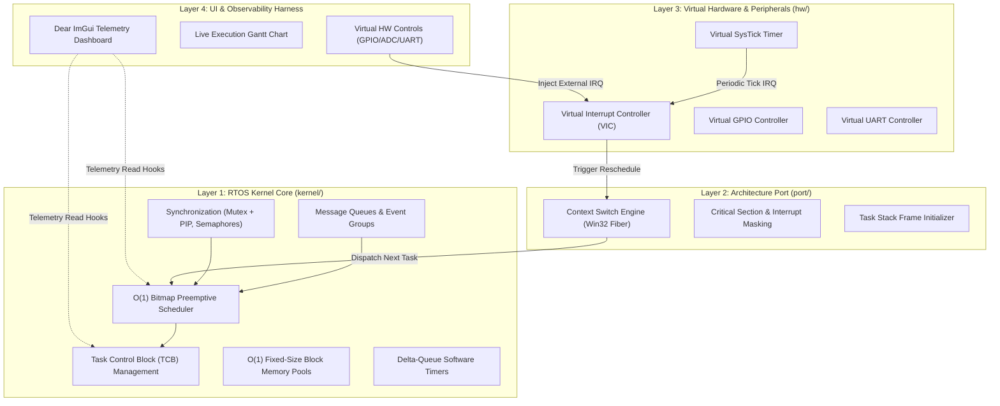
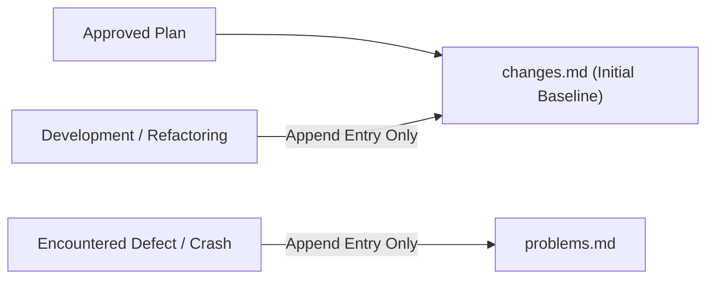

# myRTOS: Architectural Specification & Implementation Plan

> [!NOTE]
> Initial state initialized from approved implementation plan. All future changes are appended to the end of this document.

---

## 1. Technical Philosophy & Critical Reality Check

Building a "custom fully functional RTOS using C++ with a UI" carries significant engineering traps if architectural boundaries are not strictly established from day zero.

### 1.1 The Desktop Simulator Fallacy vs. True RTOS
* **The Common Mistake:** Wrapping `std::thread`, standard OS mutexes, or a simple coroutine loop inside a GUI and branding it an "RTOS".
* **The Architectural Rule:** The RTOS kernel must be strictly **freestanding and deterministic**. It must have zero knowledge of desktop operating systems, windowing libraries, or UI frameworks. The system is partitioned into four strictly decoupled layers:
  1. **RTOS Kernel Core (`kernel/`)**: Freestanding C++20. Operates on raw stacks, Task Control Blocks (TCBs), priority queues, and software interrupts.
  2. **Architecture Port (`port/`)**: Hardware abstraction layer. On a PC, it implements a host context-switching port (Win32 Fibers) to simulate CPU registers, stacks, and interrupts. On hardware, it targets ARM Cortex-M or RISC-V.
  3. **Virtual Board & Peripherals (`hw/`)**: Virtual Interrupt Controller (VIC), Virtual SysTick, Virtual GPIO, and Virtual UART.
  4. **Simulation UI & Observability Harness (`ui/`)**: Runs independently of the kernel, sampling kernel telemetry buffers and injecting hardware interrupts into the Virtual Interrupt Controller.

### 1.2 Deterministic C++ Constraints in Real-Time Systems
To guarantee real-time determinism and zero-bloat freestanding execution:
* **No Dynamic Allocation during Runtime:** `malloc`, `free`, `new`, `delete`, `std::vector`, and `std::string` are forbidden in kernel execution paths. Memory is statically allocated or serviced via an $O(1)$ fixed-block pool allocator.
* **No Exceptions or RTTI:** Compiled with `-fno-exceptions` and `-fno-rtti` (`/EHs-c- /GR-` on MSVC).
* **Zero-Cost Abstractions Only:** C++ is utilized exclusively for type safety, template-based statically sized ring buffers, compile-time assertions, and RAII-based critical section locking (`CriticalSectionGuard`).

### 1.3 Preemption Mechanics on Host Windows
On microcontrollers, preemption occurs via hardware interrupt handlers (e.g., SysTick triggering PendSV). On Windows user-space, arbitrary CPU instruction pointer manipulation is restricted.
* **The Solution:** We leverage **Win32 Fibers** (`CreateFiber`, `SwitchToFiber`, `ConvertThreadToFiber`). Each RTOS task is allocated its own private memory stack. Context switching swaps CPU registers between fibers. A high-resolution host worker drives the Virtual Interrupt Controller, triggering preemption when a higher-priority task wakes up.

---

## 2. System Architecture



---

## 3. Subsystem Specifications

### 3.1 Kernel Core (`kernel/`)

#### Task States & Control Block (TCB)
Tasks transition through standard RTOS states: `READY`, `RUNNING`, `BLOCKED`, `SUSPENDED`, and `TERMINATED`.

```
+-----------------------------------------------------------+
| Task Control Block (TCB)                                  |
+-----------------------------------------------------------+
| uint32_t           task_id                                |
| const char*        name                                   |
| TaskState          state                                  |
| Priority           base_priority      (0 = highest, 31)   |
| Priority           current_priority   (dynamic for PIP)   |
| void*              stack_ptr          (current SP)        |
| void*              stack_base         (allocation base)   |
| size_t             stack_size                             |
| uint32_t           stack_high_watermark                   |
| TickType           wake_tick          (for sleep/timeout) |
| ListNode           state_node         (intrusive list)    |
| ListNode           event_node         (waiting queue)     |
| void*              port_fiber_context                     |
+-----------------------------------------------------------+
```

#### Scheduler: $O(1)$ Priority Bitmap Engine
* **32 Priority Levels (0 to 31):** Priority 0 is the highest priority; Priority 31 is reserved for the Idle Task.
* **$O(1)$ Ready Queue:** A single 32-bit bitmap (`uint32_t ready_bitmap`) tracks non-empty priority lists.
* **Bit Manipulation Dispatch:** The next task to run is resolved via Count Leading Zeros intrinsic (`__builtin_clz` or `_BitScanReverse`), giving deterministic $O(1)$ time complexity regardless of task count.
* **Round-Robin:** Equal priority tasks are scheduled in round-robin fashion upon SysTick expiration.

#### Synchronization & IPC
1. **Priority Inheritance Mutex (PIP):**
   * Eliminates the classic **Priority Inversion** deadlock.
   * When high-priority task $H$ attempts to acquire a mutex held by low-priority task $L$, $L$'s effective priority is temporarily elevated to $H$'s priority until release.
   * Recursive locking support and ownership verification.
2. **Counting & Binary Semaphores:**
   * Interrupt-safe acquisition and release (`acquire()`, `try_acquire()`, `release_from_isr()`).
   * Blocking queue with configurable timeout.
3. **Deterministic Ring-Buffer Message Queues:**
   * Statically sized, cache-aligned circular buffer with copy-by-value semantics.
   * Zero heap allocations during enqueue/dequeue.
4. **Event Flags / Groups:**
   * 32-bit event mask supporting wait-for-all (`AND`) and wait-for-any (`OR`) synchronization.

#### Memory Management
* **Deterministic Fixed-Block Pool Allocator:**
  * Pre-allocated contiguous memory divided into uniform blocks.
  * Free list managed via embedded pointer chaining.
  * Allocation and deallocation are strictly $O(1)$ with zero risk of heap fragmentation.

---

### 3.2 Port Layer (`port/`) & Virtual Hardware (`hw/`)

#### Simulator Port Contract
* `port_init()`: Initializes host fiber environment and timer thread.
* `port_create_context()`: Initializes the task stack frame and associates it with a task fiber.
* `port_yield()`: Triggers voluntary CPU relinquishment.
* `port_enter_critical()` / `port_exit_critical()`: Nestable interrupt mask emulation.

#### Virtual Hardware Components
* **Virtual Interrupt Controller (VIC):** Manages 16 virtual interrupt lines with priority masking, pending flags, and ISR dispatch.
* **Virtual SysTick:** Configurable 1ms (1000 Hz) tick source generating IRQ 0.
* **Virtual GPIO:** 8-pin virtual port with pin-change interrupts, software debouncing, and directional control.
* **Virtual UART:** Bidirectional circular FIFO simulating TX/RX hardware registers with character-received interrupts (IRQ 1).

---

### 3.3 Simulation UI & Observability Dashboard (`ui/`)

The UI is an external instrumentation harness built with **Dear ImGui (backed by GLFW/OpenGL3)**:

| Module | Features & Visualizations |
| :--- | :--- |
| **Task Monitor Table** | Live table displaying Task ID, Name, State, Base Priority, Current Priority (PIP indicator), Stack Usage, Stack High-Water Mark, and CPU Load percentage. |
| **Execution Timeline** | Rolling Gantt chart showing real-time execution slices per task, context switches, and preemption triggers. |
| **Virtual Hardware Panel** | - 8 interactive toggle buttons simulating GPIO inputs.<br>- 8 virtual LEDs indicating GPIO output states.<br>- Interactive sliders for virtual analog/ADC inputs.<br>- Interactive UART terminal window for bidirectional RTOS shell communication. |
| **Simulation Controls** | - Play / Pause simulation.<br>- Single-step tick execution.<br>- Simulation speed slider (0.1x real-time to 10x accelerated). |

---

## 4. Documentation Protocol



### 4.1 `changes.md` Specification
* **Initial State:** Initialized with the complete text of this approved specification and implementation plan.
* **Append Rule:** All future changes will be appended to the end of the document. Existing content will remain untouched.
* **Entry Schema:**
  ```markdown
  ---
  ## [CHANGE-YYYYMMDD-ID]: <Title>
  - **Type:** Added | Modified | Removed | Refactored
  - **Components Affected:** `kernel/scheduler`, `port/simulator`, etc.
  - **Reason for Change:** Concrete engineering rationale and requirement context.
  - **Detailed Description:** Exact code, algorithm, or interface modifications.
  - **Impact Analysis:** Verification results and regression test summary.
  ```

### 4.2 `problems.md` Specification
* **Append Rule:** Every bug, crash, build failure, race condition, or architectural blocker will be appended to the end of the file. Past entries remain untouched.
* **Entry Schema:**
  ```markdown
  ---
  ## [PROBLEM-YYYYMMDD-ID]: <Short Summary>
  - **Component / Subsystem:** `kernel/mutex`, `port/context_switch`, etc.
  - **Symptom & Failure Mode:** Exact compiler error, assertion failure, deadlock, or crash log.
  - **Root Cause Analysis:** Technical explanation of memory, concurrency, or logic defect.
  - **Diagnostic Steps:** How the issue was traced, inspected, and confirmed.
  - **Solution & Resolution:** Exact fix applied and regression safeguard implemented.
  ```

---

## 5. Phased Implementation Roadmap

```mermaid
gantt
    title myRTOS Phased Implementation Roadmap
    dateFormat  X
    axisFormat  Phase %s

    section Phase 0
    Toolchain & CMake Infrastructure       :active, p0, 0, 1
    section Phase 1
    Core Kernel Types, TCB & Bitmap Queue  :p1, 1, 2
    section Phase 2
    Win32 Fiber Port & Preemptive Engine   :p2, 2, 3
    section Phase 3
    Sync Primitives (Mutex PIP, Semaphores):p3, 3, 4
    section Phase 4
    Memory Pools & Delta Software Timers   :p4, 4, 5
    section Phase 5
    Virtual Hardware Subsystem (VIC, GPIO) :p5, 5, 6
    section Phase 6
    Dear ImGui Dashboard & Gantt Visualizer:p6, 6, 7
    section Phase 7
    Verification, Edge-Case & Stress Suite :p7, 7, 8
```



### Phase 0: Toolchain & Build System Foundation
* **Tasks:**
  1. Detect/configure CMake and a C++20 compiler (`gcc`, `clang`, or MSVC `cl`).
  2. Create modular `CMakeLists.txt` with targets: `myrtos_kernel`, `myrtos_port`, `myrtos_hw`, `myrtos_ui`, `myrtos_tests`.
  3. Enforce strict compiler warnings (`-Wall -Wextra -Wpedantic` or `/W4 /WX`) and freestanding flags (`-fno-exceptions -fno-rtti`).
  4. Initialize `changes.md` with baseline plan and create `problems.md`.

### Phase 1: Core Kernel Types, TCB & Bitmap Ready Queue
* **Tasks:**
  1. Implement freestanding primitive types, bit utilities, and status codes.
  2. Implement intrusive doubly-linked list (`ListNode`, `List`) with zero dynamic allocation.
  3. Implement `TaskControlBlock` (TCB) with state tracking, stack watermark detection, and priority fields.
  4. Implement 32-priority Ready Queue with bitmapped $O(1)$ priority selection via leading zero count.

### Phase 2: Host Context-Switching Port & Preemption Engine
* **Tasks:**
  1. Implement Win32 Fiber port (`port_init`, `port_create_context`, `port_yield`, `port_switch`).
  2. Implement simulated interrupt masking (`port_enter_critical` / `port_exit_critical`).
  3. Implement simulated SysTick worker thread feeding ticks into the scheduler.
  4. Verify voluntary yields and preemptive context switching across multiple cooperative tasks.

### Phase 3: Synchronization Primitives & Priority Inversion Prevention
* **Tasks:**
  1. Implement Counting and Binary Semaphores with blocked task priority queues.
  2. Implement Mutex with Priority Inheritance Protocol (PIP) to prevent priority inversion.
  3. Implement Statically Sized Circular Message Queues with timeout mechanisms.
  4. Implement 32-bit Event Groups supporting `WaitAny` and `WaitAll`.

### Phase 4: Deterministic Memory Management & Software Timers
* **Tasks:**
  1. Implement $O(1)$ Fixed-Block Memory Pool Allocator with free-list pointer overlay.
  2. Implement delta-queue Software Timers (one-shot and periodic).
  3. Integrate software timer expiration into the SysTick processing pipeline.

### Phase 5: Virtual Hardware & Peripheral Subsystem
* **Tasks:**
  1. Implement Virtual Interrupt Controller (VIC) supporting 16 priority-vectored IRQ lines.
  2. Implement Virtual GPIO controller with pin-change interrupt generation.
  3. Implement Virtual UART controller with ring-buffered TX/RX registers and character reception interrupts.

### Phase 6: Dear ImGui Telemetry & Control Dashboard
* **Tasks:**
  1. Integrate Dear ImGui (via GLFW/OpenGL3 or SDL2) into the CMake build.
  2. Implement kernel telemetry collection ring buffers (context switch log, task metrics).
  3. Build the Task Monitor Table and live execution Gantt chart timeline.
  4. Build Virtual Hardware interactive panel (GPIO buttons, LED status indicators, UART console).
  5. Build simulation controls (Play, Pause, Step-Tick, Speed Slider).

### Phase 7: Verification, Edge-Case & Stress Testing
* **Tasks:**
  1. **Unit Test Suite:** Priority scheduler correctness, FIFO ordering at equal priority, message queue boundary tests.
  2. **Priority Inversion Verification Test:** Explicit test validating that a medium-priority task cannot preempt a low-priority task holding a mutex required by a high-priority task.
  3. **Stack Canary & Overflow Detection:** Enforce watermark checks and boundary canary verification.
  4. **Interrupt Storm Stress Test:** Inject 10,000 rapid virtual GPIO/UART interrupts and verify system stability.

---

## 6. Approved Architecture Configuration
1. **Host Context Switch Engine:** Win32 Fibers (`CreateFiber`, `SwitchToFiber`, `ConvertThreadToFiber`).
2. **Observability UI:** Dear ImGui with GLFW/OpenGL3 backend.
3. **Target Toolchain:** MinGW (C++20 / C++17 compliant).

---

## [CHANGE-20261012-01]: Core Freestanding Kernel, Win32 Fiber Port, and Virtual Peripherals
- **Type:** Added
- **Components Affected:** `kernel/`, `port/`, `hw/`, `tests/`, `examples/`, `CMakeLists.txt`
- **Reason for Change:** Implement initial freestanding RTOS architecture, host simulation port, virtual hardware peripherals, and verification test harness according to the approved architectural specification.
- **Detailed Description:**
  - Configured 64-bit MinGW-w64 toolchain (GCC 16.2.0, CMake 4.4.2, Ninja 1.13.2) located at `D:\mingw64\bin`.
  - Created `kernel/include/kernel/types.hpp`: Freestanding fixed-width types, task states, status codes, and bit manipulation intrinsics (`count_leading_zeros`).
  - Created `kernel/include/kernel/list.hpp`: Intrusive doubly-linked list with $O(1)$ insertions/removals and sorted delta-queue insertion.
  - Created `kernel/include/kernel/tcb.hpp`: Task Control Block with stack watermark calculation and `0xDEADBEEF` stack canary validation.
  - Created `kernel/src/scheduler.cpp`: Preemptive $O(1)$ 32-priority bitmap scheduler with Round-Robin equal priority rotation.
  - Created `kernel/src/semaphore.cpp`: Counting and binary semaphores with interrupt-safe acquisition and release.
  - Created `kernel/src/mutex.cpp`: Recursive mutex with Priority Inheritance Protocol (PIP) to prevent priority inversion.
  - Created `kernel/src/queue.cpp`: Circular ring-buffer message queue with timeout blocking and zero runtime heap allocations.
  - Created `kernel/src/memory_pool.cpp`: $O(1)$ fixed-size block pool allocator with embedded free-list chaining.
  - Created `kernel/src/timer.cpp`: Software timers and delta-queue dispatch manager.
  - Created `port/simulator/port_win32.cpp`: Win32 Fiber context switching, nestable critical sections, and 1ms multimedia timer SysTick worker thread.
  - Created `hw/src/vic.cpp`: Virtual Interrupt Controller (VIC) with 16 priority-vectored IRQ lines.
  - Created `hw/src/gpio.cpp`: Virtual GPIO controller with edge-triggered interrupt simulation.
  - Created `hw/src/uart.cpp`: Virtual UART controller with circular RX/TX FIFOs.
  - Created `tests/main_tests.cpp`: Unit test suite verifying all kernel primitives.
  - Created `examples/main_sim.cpp`: Interactive multi-task demonstration application.
  - Automated test suite `myrtos_tests` executed and passed all 7/7 tests cleanly.
  - Simulator demo `myrtos_sim` confirmed multi-tasking execution, queue communication, semaphore synchronization, and UART telemetry output.

---

## [CHANGE-20261012-02]: Phase 6 Interactive Dear ImGui Telemetry & Control Dashboard
- **Type:** Added
- **Components Affected:** `ui/`, `third_party/`, `examples/main_gui.cpp`, `CMakeLists.txt`
- **Reason for Change:** Implement Phase 6 interactive simulation dashboard allowing real-time observability into task scheduling, CPU memory watermarks, virtual hardware manipulation, and UART serial communication.
- **Detailed Description:**
  - Integrated `third_party/glfw` and `third_party/imgui` (with OpenGL3 and GLFW backends).
  - Created `ui/include/ui/dashboard.hpp` and `ui/src/dashboard.cpp`:
    - **Simulation Control Bar:** Pause/Resume toggle, single-step 1ms tick execution, and speed multiplier (1x to 10x).
    - **Task Control Block Table:** Live rendering of Task ID, Name, State (`RUNNING`, `READY`, `BLOCKED`, `SUSPENDED`), Priority (with PIP elevation indicators), Stack Free (watermark bytes), Stack Usage Progress Bar, and context switch counts.
    - **Rolling Execution Timeline (Gantt Chart):** Live graphical representation of active tasks on each tick with unique color codes.
    - **Virtual Hardware Panel:** Interactive 8-pin GPIO cards with clickable buttons to toggle pin states, generate edge-triggered interrupts into the VIC, and animated LED status circles.
    - **Virtual UART Console:** Live terminal history window pulling character streams from the Virtual UART TX buffer, alongside an interactive text input bar to inject simulated UART RX commands.
  - Created `examples/main_gui.cpp`: Dual-threaded application decoupling the RTOS fiber kernel loop from the 60 FPS GLFW UI rendering loop.
  - Updated `CMakeLists.txt` to build `myrtos_ui` static library and `myrtos_dashboard.exe` executable with standalone MinGW static linking.
  - Executable `build/myrtos_dashboard.exe` built and executed successfully with zero runtime DLL dependencies.

---

## [CHANGE-20261012-03]: Added .gitignore and Comprehensive Beginner-Friendly README.md
- **Type:** Added
- **Components Affected:** `.gitignore`, `README.md`
- **Reason for Change:** Establish version control hygiene by ignoring build artifacts and compiled binaries, and provide complete, accessible documentation explaining the architecture, mechanics, toolchain choices, setup, and usage of myRTOS for beginners with inline definitions for all technical terminology.
- **Detailed Description:**
  - Created `.gitignore`:
    - Ignores build directories (`build/`, `bin/`, `out/`).
    - Ignores compiled binaries and libraries (`*.exe`, `*.o`, `*.obj`, `*.a`, `*.lib`, `*.dll`).
    - Ignores editor configurations and temporary CMake caches (`.vscode/`, `.idea/`, `CMakeCache.txt`, etc.).
  - Created `README.md`:
    - Explains fundamental RTOS concepts in simple terms with technical meanings annotated in brackets.
    - Details the 4-layer architecture separating kernel core, hardware port, virtual peripherals, and UI harness.
    - Documents technologies used (C++20, CMake, MinGW-w64, Ninja, Win32 Fibers, Dear ImGui, GLFW) and rationale.
    - Walks through internal mechanisms: TCBs, stack canaries, watermark detection, $O(1)$ bitmap scheduler, Priority Inheritance Protocol (PIP) resolving priority inversion, fixed-block memory pools, delta software timers, and virtual peripherals.
    - Provides step-by-step setup, compilation, and execution commands for `myrtos_tests.exe`, `myrtos_sim.exe`, and `myrtos_dashboard.exe`.
- **Impact Analysis:**
  - Repository structure is clean, ready for version control, and fully documented for new developers.

---

## [CHANGE-20261012-04]: Universal Portability Refactoring for README.md and CMakeLists.txt
- **Type:** Modified
- **Components Affected:** `README.md`, `CMakeLists.txt`
- **Reason for Change:** Eliminate machine-specific absolute paths from `README.md` to ensure any developer cloning the repository from GitHub can setup, compile, and run the project portably, and add CMake `FetchContent` automatic dependency resolution for third-party libraries (`glfw` and `imgui`).
- **Detailed Description:**
  - Updated `CMakeLists.txt`:
    - Added `include(FetchContent)`.
    - Added automatic download fallback for `glfw` (v3.4) and `imgui` (v1.91.8) if the local `third_party/` directory is not present in fresh clones.
  - Refactored `README.md`:
    - Removed all local machine directory references (e.g. `D:\...`).
    - Provided standard GitHub clone instructions (`git clone`, `cd myRTOS`).
    - Documented universal CMake generation commands for multiple build generators (Ninja, MinGW Makefiles, Visual Studio).
    - Added portable execution commands using relative paths (`.\build\myrtos_tests.exe`, `.\build\myrtos_sim.exe`, `.\build\myrtos_dashboard.exe`).
- **Impact Analysis:**
  - The repository is 100% portable, reproducible, and ready for public GitHub publication.

---

## [CHANGE-20261012-05]: Docker Containerization, POSIX ucontext Host Port, and Browser-Based noVNC Streaming
- **Type:** Added & Modified
- **Components Affected:** `port/simulator/port_posix.cpp`, `CMakeLists.txt`, `examples/main_gui.cpp`, `Dockerfile`, `docker-compose.yml`, `entrypoint.sh`, `README.md`
- **Reason for Change:** Provide a zero-installation, completely containerized development and execution environment allowing users on any host OS (Windows, Linux, macOS) to compile the RTOS and interact with the graphical Dear ImGui dashboard directly inside any modern web browser via WebSockets.
- **Detailed Description:**
  - Created `port/simulator/port_posix.cpp`:
    - Implemented host context switching for UNIX/Linux/macOS environments using POSIX `<ucontext.h>` primitives (`getcontext`, `makecontext`, `swapcontext`, `setcontext`).
    - Allocated static context shim structures (`TaskContextShim`) and `ucontext_t` slots for up to 32 tasks, guaranteeing zero runtime dynamic heap allocation.
    - Implemented critical section masking using `pthread_mutex_t` (`PTHREAD_MUTEX_INITIALIZER`).
    - Implemented hardware SysTick timer thread using a dedicated `pthread` and high-resolution `nanosleep` (1,000,000 ns = 1 ms) feeding `IRQ_SYSTICK` into the Virtual Interrupt Controller.
    - Added host CPU yield in idle task via `usleep(1000)` to prevent 100% CPU starvation of the background timer thread.
  - Refactored `examples/main_gui.cpp`:
    - Replaced Win32-specific `CreateThread` with portable C++11/C++20 `std::thread`, allowing identical source compilation across both native Windows and Linux/POSIX targets.
  - Updated `CMakeLists.txt`:
    - Added platform conditional branching for `myrtos_port`: compiles `port_win32.cpp` with `kernel32` and `winmm` on Windows, and `port_posix.cpp` with `pthread` on non-Windows systems.
    - Added cross-platform OpenGL discovery (`find_package(OpenGL REQUIRED)`) and target linkage (`OpenGL::GL`) for Linux/POSIX environments.
  - Created `Dockerfile`:
    - Based on Ubuntu 24.04 LTS.
    - Installs GCC/G++ C++20 toolchain, CMake, Ninja, Git, Mesa OpenGL graphics development headers, X11 libraries, and headless streaming utilities (`xvfb`, `openbox`, `x11vnc`, `novnc`, `websockify`).
    - Configures and compiles the complete project with Ninja in Release mode.
    - Executes the automated test suite `myrtos_tests` during Docker build to guarantee kernel integrity before image creation.
    - Exposes port 8080 and configures `entrypoint.sh`.
  - Created `entrypoint.sh`:
    - Establishes a 4-tier virtual display pipeline:
      1. Launches `Xvfb` on virtual display `:0` with a 1280x820 24-bit in-memory framebuffer screen.
      2. Launches `openbox` window manager to manage window focus and events.
      3. Launches `x11vnc` VNC server capturing the `:0` display on port 5900.
      4. Launches `websockify` bridging the VNC port to an HTML5 noVNC web server on port 8080.
      5. Executes `/app/build/myrtos_dashboard`, rendering the Dear ImGui interface directly to the virtual framebuffer.
  - Created `docker-compose.yml`:
    - Single-command orchestration mapping container port 8080 to host port 8080.
- **Impact Analysis:**
  - Users can launch the full graphical simulator without installing MinGW, CMake, or graphics drivers locally by running `docker compose up --build` and visiting `http://localhost:8080/vnc.html`.
  - All native Windows targets (`myrtos_tests.exe`, `myrtos_sim.exe`, `myrtos_dashboard.exe`) compile and execute with zero regressions.

---

## [CHANGE-20261012-06]: README.md Quick Start, Badges, Features Showcase, and Portability Link Normalization
- **Type:** Modified
- **Components Affected:** `README.md`
- **Reason for Change:** Elevate repository documentation to modern open-source standards by adding status badges, a 30-second Quick Start section directly in the introduction, a key features showcase, fixing section numbering alignment across all 12 sections in the Table of Contents, and converting machine-specific absolute file links in the documentation audit trail to portable relative links for GitHub publication.
- **Detailed Description:**
  - Added repository status badges for C++20, CMake 3.20+, Docker containerization, Dear ImGui, test status (7/7 passing), multi-platform support (Windows/Linux/macOS), and MIT license.
  - Enhanced introduction to explicitly highlight both native desktop compilation and zero-installation browser-based simulation via Docker and noVNC WebSockets.
  - Added Section 1: **Quick Start: Try It in 30 Seconds!** providing immediate copy-paste commands for:
    - Option A: Docker browser simulation (`docker compose up --build` -> `http://localhost:8080/vnc.html`).
    - Option B: Native CMake/Ninja compilation and desktop dashboard execution.
  - Added Section 2: **Key Features & Highlights** showcasing the core RTOS capabilities with beginner-friendly inline definitions in brackets.
  - Unified and renumbered all 12 sections in the Table of Contents and corresponding section headings:
    - Section 1: Quick Start (30 Seconds)
    - Section 2: Key Features & Highlights
    - Section 3: What is an RTOS?
    - Section 4: Project Architecture
    - Section 5: Technologies Used & Rationale
    - Section 6: Internal Operating System Mechanics
    - Section 7: Project Directory Layout
    - Section 8: Docker & Browser-Based Simulation
    - Section 9: Native Host Prerequisites & Setup
    - Section 10: Building the Project (CMake Workflow)
    - Section 11: Running Executables Locally
    - Section 12: Documentation & Audit Trail
  - Corrected audit trail markdown links in Section 12 from machine-specific absolute URIs to clean, portable repository-relative links (`[changes.md](changes.md)` and `[problems.md](problems.md)`).
- **Impact Analysis:**
  - `README.md` is immediately actionable for new visitors on GitHub without requiring scrolling past hundreds of lines of theory to find execution commands.
  - All anchor links, directory paths, and file references are 100% portable across GitHub and any developer workstation.

---

## [CHANGE-20261012-07]: Disabled GLFW Wayland Scanning for Headless X11 Docker Build
- **Type:** Modified
- **Components Affected:** `CMakeLists.txt`, `Dockerfile`, `problems.md`
- **Reason for Change:** Resolve Docker build failure where GLFW 3.4 attempted to build Wayland protocols by default and errored out due to missing `wayland-scanner`. The simulation environment uses Xvfb, which is an X11 server, rendering Wayland support unnecessary.
- **Detailed Description:**
  - Updated `CMakeLists.txt` to enforce `set(GLFW_BUILD_WAYLAND OFF CACHE BOOL "" FORCE)` and `set(GLFW_BUILD_X11 ON CACHE BOOL "" FORCE)`.
  - Updated `Dockerfile` CMake command line to add `-DGLFW_BUILD_WAYLAND=OFF`.
  - Appended root cause analysis and resolution to `problems.md` under `[PROBLEM-20261012-07]`.
- **Impact Analysis:**
  - Docker container compilation now configures GLFW with pure X11 support, eliminating the `wayland-scanner` missing dependency error.
  - The base Ubuntu layer in Docker remains cached from the previous build attempt, allowing the build to resume rapidly without re-downloading packages.


